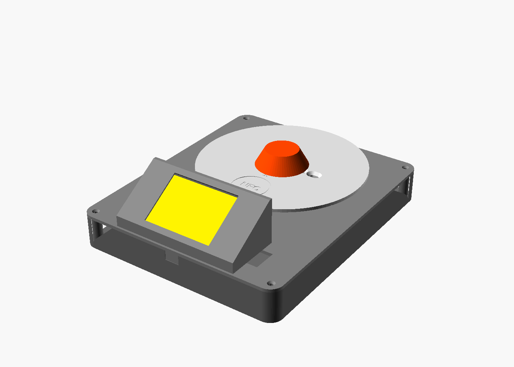

# 2. Impressão da caixa (v0)

Arquivos em [`hardware/stl/`](../hardware/stl). Fonte paramétrica: [`hardware/central.scad`](../hardware/central.scad).

> **v0 = medidas padrão das peças.** Furos da célula de carga são em **rasgo** (±2 mm) e o
> PN532, o HX711 e a CYD são presos com **fita dupla-face/cola quente**, para funcionar mesmo
> que a sua peça tenha medidas um pouco diferentes. Na v1 eu ajusto com as suas medidas.

## Peças

**Tudo num arquivo só:** [`hardware/stl/central-nfc-v0.3mf`](../hardware/stl/central-nfc-v0.3mf)
— abra no Bambu Studio com a **H2S** selecionada e aperte **A** (Organizar todos os objetos).
Ele divide sozinho nas placas que precisar.

**Cores já definidas no 3MF** (preto + cinza). Ao abrir, o Bambu Studio pergunta como ligar as
cores aos filamentos — escolha o preto e o cinza do AMS.

| Peça | Cor |
|---|---|
| Bandeja | cinza |
| Tampa, pod, cone | preto |
| Prato | cinza, com a marca NFC (círculo, texto e seta) em preto |

Todos os STL já estão **na posição de impressão** — é só abrir no fatiador e fatiar. Nenhuma precisa de suporte.

| Arquivo | Tamanho (mm) | Posição | Observação |
|---|---|---|---|
| `bandeja.stl` | 200 × 240 × 29 | fundo na mesa | maior peça (~3–4 h) |
| `tampa.stl` | 200 × 240 × 3 | face de cima na mesa | fica lisa por cima |
| `prato.stl` | Ø160 × 17 | face de cima na mesa | marca NFC gravada |
| `pod.stl` | 120 × 53 × 42 | apoiado na face de trás | fechado atrás; a CYD entra por baixo |
| `cone.stl` | Ø50 × 19 | ponta fina na mesa | |

**Configuração sugerida:** PETG ou PLA, bico 0.4, camada 0.2, 3 paredes, 15–20% de preenchimento
(gyroid). Cabe na mesa da U1 (270×270) e da H2S.

Teste primeiro **o pod** (rápido) — ele mostra se a janela da tela ficou boa.

## Parafusos e materiais

| Item | Qtd | Onde |
|---|---|---|
| M3 × 10 autoatarraxante (ou para plástico), cabeça **escareada** | 8 | 4 tampa→bandeja, 4 pod→tampa |
| **M5 × 25** ou **M4 × 25**, cabeça **escareada** (DIN 7991) | 2 | prato → ponta livre da célula |
| **M5 × 16** ou **M4 × 16**, cabeça cilíndrica (Allen) | 2 | bandeja → ponta fixa da célula |
| Pés de borracha adesivos Ø12 | 4 | embaixo da bandeja |
| Fita dupla-face espessa / cola quente | — | PN532, HX711, CYD |

Confira qual rosca tem a sua célula (geralmente **M4 numa ponta e M5 na outra**). Os furos aceitam os dois.

## Montagem

1. **Célula de carga na bandeja**
   - Ponta fixa no **bloco da esquerda**, parafusos por baixo da bandeja.
   - A **seta** gravada na célula aponta **para baixo**.
   - A ponta direita tem que ficar **solta no ar** (sem encostar no fundo).
2. **HX711** na moldurinha ao lado da célula, com fita dupla-face.
3. **PN532** no bolso embaixo da tampa (antena virada **para cima**, encostando na tampa), com fita.
4. **CYD** no pod, entrando **por baixo**: o vidro da tela encaixa no rebaixo atrás da janela.
   Ligue o cabo USB antes e prenda a placa com cola quente nos cantos (não na tela).
5. **Pod na tampa**: 4 parafusos M3 por baixo da tampa. Os cabos passam pelo rasgo da tampa.
6. **Tampa na bandeja**: 4 parafusos M3 nos cantos. O cabo USB passa entre os pinos e sai pelo rasgo de trás.
7. **Prato**: a coluna passa pelo furo da tampa e apoia na ponta livre da célula.
   Parafusos escareados por cima (ficam rentes).
   - O prato **não pode encostar na tampa** — confira se ele balança livre ~4 mm acima dela.
8. **Cone**: encaixe no furo central do prato.

## Alimentação (cabo escondido)

Tudo é alimentado por **um único cabo USB** ligado na CYD. O PN532 e o HX711 recebem 3.3V da
própria CYD. Use qualquer carregador de celular **5V / 1A** ou mais.

Caminho do cabo:

1. Liga na CYD **dentro do pod** com um **cabo USB-C em L (90°)** — sobram ~14 mm de cada lado
   da placa, não cabe plugue reto. Busque "cabo usb-c 90 graus".
2. Desce pelo **rasgo largo da tampa**, embaixo do pod.
3. Passa **por dentro da bandeja**, rente à parede lateral, até o lado do rolo.
4. Passa **apertado entre os dois pinos** embaixo da tampa (trava contra puxão).
5. Sai pelo **rasgo da parede de trás** (lado do rolo).

O rasgo da frente da bandeja (da v0) é fechado por um **tampão** que já vem na tampa.

### Bandeja v0 já impressa (sem saída atrás)

Faça um rasgo de **8 mm de largura × 10 mm de profundidade** no topo da parede de trás, alinhado
com os dois pinos da tampa (coloque a tampa por cima para marcar). Ferro de solda, estilete
aquecido ou broca + lima resolvem. Ou reimprima a bandeja — o arquivo novo já tem o rasgo.

## Antes de fechar tudo

Faça o [teste do hardware](01-teste-do-hardware.md) com a balança já montada na bandeja:
calibre e confira se o peso é o mesmo com o rolo em posições diferentes do prato.

## Me mande depois de imprimir

- O que encaixou mal (folga ou aperto) e quanto
- Se a tag lê através do prato (marca NFC)
- Fotos 🙂
